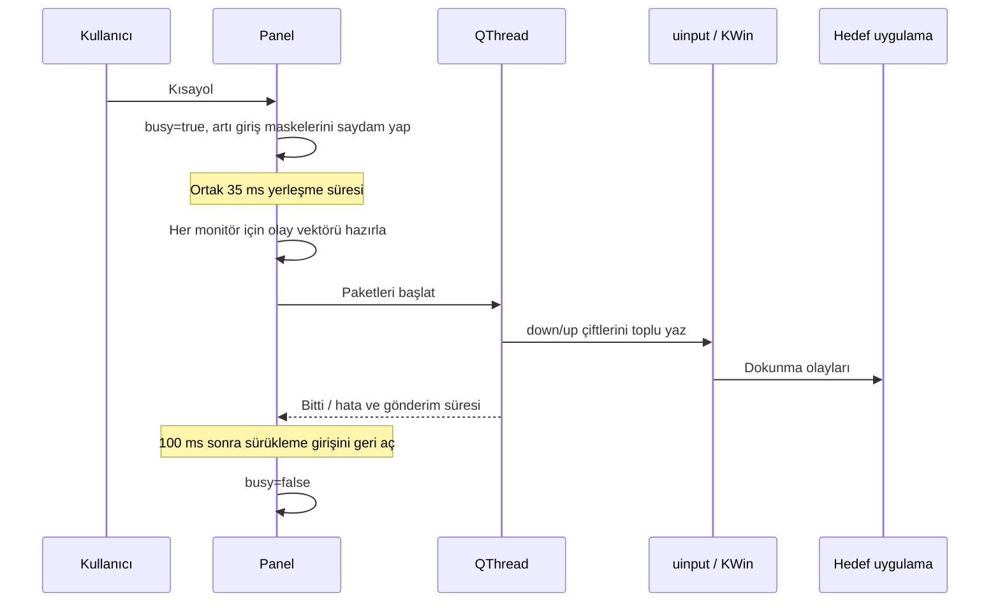

# ClickW mimarisi

## Yapı

Uygulama C++17 ile yazılmış tek çalıştırılabilir dosyadır. Mevcut üretim sınıfları ve kontrollü GUI testleri `main.cpp` içindedir; bu başlangıç çalışması kodu modüllere ayırmaz.

| Bileşen | Sorumluluk |
| --- | --- |
| `Marker` | Merkez/yerel koordinat, monitör adı, QPointer ekran referansı, kilit ve görünürlük |
| `Canvas` | Ekran başına sabit LayerShellQt katmanı, artı çizimi, giriş maskesi ve sürükleme |
| `TouchDevice` | libevdev/uinput aygıtı, KWin ekran eşlemesi, olay üretimi ve paket yazımı |
| `Panel` | Kullanıcı arayüzü, kayıtlar, kısayol, ekran yenileme, giriş işi ve kapanma |
| `TestTarget` | Kontrollü test penceresinde gelen dokunma/mouse olaylarını ve zamanlarını sayma |
| `main` | QApplication, tek örnek kilidi ve çalışma/test modlarının seçimi |

## Tıklama akışı

Her nokta 12 `input_event` içerir: dokunma, koordinat/tracking bilgileri ve SYN_REPORT; ardından bırakma ve SYN_REPORT. Çoklu dokunma yerine bağımsız çiftler kullanılır. Normal durumda monitör başına bir yazım yapılır; `sendBatch` EINTR ve kısmi yazımı işler. Olay vektörleri GUI tarafında hazırlanır. Worker QWidget veya QScreen'e erişmez; paket ve canlı TouchDevice referanslarıyla çalışır.

Kernel'e gönderim süresi `lastBatchNs` ile ölçülür. Bu ölçüm 35 ms hazırlık, worker'ın çalışmaya başlaması, 100 ms giriş maskesi geri açılması veya hedefin ağ/çizim süresini kapsamaz.

## Katman ve koordinatlar

Katmanlar ekran boyutundadır ve sürüklemede taşınmaz. Pointer koordinatları sürükleme başladığı ekranın sabit yüzeyine göre okunur; global noktaya çevrilerek `Marker::place` çağrılır. Hedef ekran bu global noktadan seçilir, monitör boşluklarında en yakın ekran kullanılır. Her canvas yalnızca kendi ekranındaki artıları çizer.

Giriş maskesi görünür artıların 24×24 bölgelerinin birleşimidir. Boş `QRegion` tam pencere maskesini geri açabileceğinden boş giriş için ekran dışında 1×1 bölge kullanılır. Tıklama sırasında maskeler giriş almaz; çizim sürer.

Dokunmatik koordinatları hedef monitörün mantıksal geometrisinden 0–65535 aralığına çevrilir. KWin `outputName` ve `mapToWorkspace=false` ile aygıt monitöre eşlenir. Bu arayüz KDE'ye özeldir.

## Yaşam döngüsü

`busy`, aynı anda ikinci tıklama işini engeller. Ekran değişikliği `ready=false` yapar ve 75 ms birleştirme zamanlayıcısıyla yeniden kurulumu planlar. Çalışan worker bitmeden `syncScreens` aygıtları silmez. `QPointer<QScreen>` kaldırılan ekranların geçersiz referanslarını yakalar.

`closeEvent`, Kapat ve `aboutToQuit`, idempotent `shutdown` akışına gider: zamanlayıcıları durdur, kısayolu kaldır, canvas'ları sil, konumları sakla, worker'ı bekle/yok et, sanal aygıtları yok et ve uygulamadan çık. Ekran katmanları panel kapanınca uygulamanın açık kalmasına neden olmamalıdır.

## Kayıt ve dosyalar

Normal ayarlar `~/.config/ClickW/clickw.conf`; tek örnek kilidi `$XDG_RUNTIME_DIR/clickw.lock` içindedir. Test ayarları `/tmp/clickw-selftest-<pid>/` altında izoledir. Kayıtlarda `markerCount`, `shortcut`, `pointN`, `screenN`, `localN` kullanılır. Bunlar kullanıcı verisidir ve depoya yüklenmez.

`CMakeLists.txt` derleme bağımlılıklarını bulur. `Başlat.sh` çalışma dizinini kaynak köküne ayarlar ve Wayland/Türkçe locale ile `build/clickw` çalıştırır. `ClickW.desktop.in` yerel launcher şablonudur; CMake derleme dizininde gerçek yollarla üretir. `clickw.svg` sürümlenen uygulama ikonudur.
